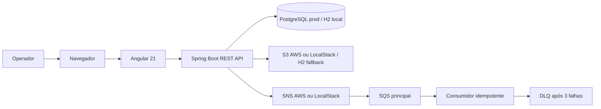

# Retirement Benefits System — SEPLAG/COTEC Technical Assessment

A full-stack portfolio application developed for a **SEPLAG/COTEC technical selection assessment**, focused on managing **public-servant retirement benefit requests** and their supporting documents.

> **Project provenance:** This is a technical-assessment project, **not** the similarly named *Benefícios onLine* employee-benefits and reimbursement system I worked on professionally at **COGERH**. They are separate projects with different business domains. This repository is not presented as an official SEPLAG deployment or a production system.

## Business context

A retirement-benefit request involves identifying a public servant, recording a benefit application, organizing documents and tracking its movement between administrative departments. This repository demonstrates these concepts in a web application.

## Main capabilities

- Register and consult retirement-benefit requests.
- Associate PDF documents with benefit requests and organize them by category.
- Record the movement of requests between departments (*tramitação*).
- Expose REST endpoints for the application workflow.
- Provide a separate Angular frontend for interacting with the backend.
- Store documents in S3 when the AWS integration is enabled, with database fallback for local H2 development.
- Publish domain events through SNS and consume them through SQS with retry, DLQ and idempotency protection.

These describe the project's intended and implemented code areas; they are not claims of production deployment or exhaustive end-to-end test coverage.

## Technology stack

| Area | Technology |
| --- | --- |
| Backend | Java 21, Spring Boot 4.0.2 |
| REST and persistence | Spring Web MVC, Spring Data JPA / Hibernate |
| Validation | Spring Boot Validation |
| Database | H2 for local development; PostgreSQL 17 for the containerized setup |
| Schema management | Flyway |
| API documentation | Springdoc OpenAPI 3 / Swagger UI |
| Frontend | Angular 21, TypeScript, Router, Reactive Forms, Signals |
| AWS integration | AWS SDK for Java 2.x, S3, SNS, SQS, DLQ |
| Local cloud emulation | LocalStack |
| Infrastructure as code | Terraform, IAM least-privilege policies |
| Build and deployment | Maven Wrapper, npm, Docker, Docker Compose |
| Testing | JUnit 5, Spring Boot Test, MockMvc, Vitest configuration, Playwright configuration |

## Repository structure

```text
.
├── backend/           # Spring Boot REST API, domain, persistence and migrations
├── frontend/          # Angular web application
├── docs/              # Supporting documentation
├── docker-compose.yml # Backend, PostgreSQL and LocalStack services
├── terraform/         # AWS infrastructure and least-privilege IAM
└── README.md
```

## Visão geral



## Running locally

**Prerequisites:** JDK 21 and Node.js/npm compatible with the Angular project.

Backend (from the repository root):

```bash
cd backend
./mvnw spring-boot:run
```

On Windows, use `mvnw.cmd spring-boot:run`. The default backend configuration uses an in-memory H2 database.

Frontend (in another terminal):

```bash
cd frontend
npm install
npm start
```

The repository also includes a `docker-compose.yml` defining PostgreSQL, the backend and LocalStack with SNS/SQS. The backend image uses a multi-stage Docker build and does not require a locally generated JAR. To try that setup from the repository root:

```bash
docker compose up --build
```

The Docker Compose credentials are development examples and must not be reused for a public deployment. The frontend is not included as a service in this Compose file. See [AWS and messaging](docs/aws-messaging.md) for the SNS/SQS flow and AWS configuration.

The `terraform/` directory contains the AWS version of the infrastructure, including S3, SNS, SQS, the DLQ and the backend IAM role. Use LocalStack for local development and review `terraform plan` before any real AWS apply.

## Architecture roadmap

The current implementation uses AWS SNS/SQS for event publication and asynchronous processing. The project is being evolved to evaluate additional messaging technologies in focused scenarios:

- **RabbitMQ** for work queues, routing through exchanges and document-processing tasks;
- **Apache Kafka** for event streaming, durable event history, replay and multiple independent consumers.

These technologies are planned as complementary alternatives for specific workloads, not as simultaneous replacements for SNS/SQS. SNS/SQS remains the primary AWS-native messaging path, while RabbitMQ and Kafka will be evaluated through isolated Docker Compose profiles and documented trade-offs.

## Scope and limitations

- Built as a **recruitment technical assessment and portfolio demonstration**, not a government production application.
- No official deployment, institutional affiliation or production readiness is claimed.
- The existence of test dependencies does not establish test coverage or successful CI execution.
- Authentication, authorization, sensitive-document storage and operational security require review before any real-world deployment.

## Professional context

I also developed a separate employee-benefits system called *Benefícios onLine* while working at **COGERH**. Despite the similar name, that professional work concerned employee benefits and reimbursements, whereas this repository concerns **retirement benefit requests** and originated from a **SEPLAG/COTEC selection exercise**.

## Author

**Fernando Ellery** — Senior Software Engineer specializing in Java, Spring Boot, REST APIs and enterprise applications.

- [GitHub](https://github.com/fefeutitan)
- [LinkedIn](https://www.linkedin.com/in/fernando-ellery/)
