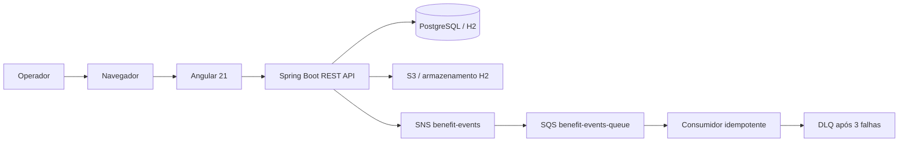

# Arquitetura

O projeto é organizado como um monorepo full-stack para gerenciamento de processos de aposentadoria:

```text
retirement-benefits-system/
├── backend/       # API REST Java 21 + Spring Boot
├── frontend/      # SPA Angular 21
├── localstack/    # Inicialização local de S3, SNS e SQS
├── terraform/     # Infraestrutura AWS e políticas IAM
├── docs/          # Documentação funcional e técnica
└── docker-compose.yml
```

## Visão geral



## Backend

O backend utiliza:

- Java 21;
- Spring Boot 4.0.2;
- Spring MVC;
- Spring Data JPA / Hibernate;
- Bean Validation;
- Flyway;
- Springdoc OpenAPI / Swagger UI;
- JUnit 5, Spring Boot Test e MockMvc.

O domínio principal contém benefícios, documentos e tramitações. O backend valida os PDFs, controla os status do processo e expõe endpoints REST para o frontend.

Endpoints principais:

- `GET /api/status`;
- `POST /api/beneficios`;
- `GET /api/beneficios`;
- `POST /api/beneficios/{id}/documentos`;
- `GET /api/beneficios/{id}/documentos/{documentoId}/conteudo`;
- `POST /api/beneficios/{id}/tramitacoes`;
- `GET /api/beneficios/{id}/tramitacoes`;
- `GET /v3/api-docs`;
- `GET /swagger-ui.html`.

## Persistência e documentos

No perfil padrão, o sistema utiliza H2 em memória. No perfil `prod`, utiliza PostgreSQL com migrações Flyway.

O armazenamento de PDFs possui duas estratégias:

- AWS habilitada: o conteúdo é armazenado no S3 e o banco guarda a chave do objeto;
- AWS desabilitada: o conteúdo permanece no banco H2 para facilitar o desenvolvimento local.

O bucket S3 é privado, criptografado e versionado quando provisionado pelo Terraform.

## Mensageria

Ao criar um benefício, o backend publica um evento `BeneficioCriado` no tópico SNS `benefit-events`.

O SNS entrega o evento para a fila SQS `benefit-events-queue`. O consumidor:

1. Recebe a mensagem;
2. Verifica o `eventId` na tabela `processed_event`;
3. Ignora eventos já processados;
4. Executa o processamento para eventos novos;
5. Registra o evento como processado;
6. Remove a mensagem da SQS somente após o sucesso.

A fila possui uma redrive policy com `maxReceiveCount=3`. Mensagens que falham repetidamente são encaminhadas para `benefit-events-dlq`.

## Desenvolvimento local

O Docker Compose executa:

- Backend Spring Boot;
- PostgreSQL;
- LocalStack com S3, SNS e SQS;
- Bucket, tópico, fila e subscription inicializados por `localstack/init-aws.sh`.

```bash
docker compose up --build
```

O perfil local usa credenciais fictícias do LocalStack. Elas não devem ser utilizadas em uma conta AWS real.

## AWS e infraestrutura

O diretório `terraform/` descreve os recursos AWS:

- S3 para documentos;
- SNS para publicação de eventos;
- SQS para processamento assíncrono;
- DLQ para falhas permanentes;
- Subscription SNS → SQS;
- IAM Role para o backend;
- Políticas IAM com permissões mínimas para S3, SNS e SQS.

O Terraform representa a infraestrutura real, enquanto o LocalStack fornece uma implementação local para desenvolvimento e testes.

## Frontend

O frontend utiliza Angular 21 com:

- Componentes standalone;
- Angular Router;
- Signals;
- Reactive Forms;
- Upload e visualização de PDFs;
- Histórico de tramitações;
- Configuração para Vitest e Playwright.

## Limitações e evolução

O projeto ainda requer autenticação, autorização, observabilidade com CloudWatch, Outbox Pattern e deploy em ECS/Fargate para uma operação de produção.

Kafka e RabbitMQ estão no roadmap como alternativas para cenários específicos de streaming e filas de trabalho; SNS/SQS permanece a mensageria AWS principal.
