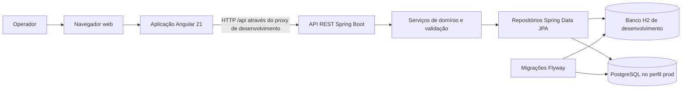

# Problema de negócio

Solicita-se o desenvolvimento de uma aplicação para criação e tramitação de benefícios de aposentadoria para servidores.

## Requisitos funcionais

A aplicação deverá permitir criar um benefício de aposentadoria para um servidor com os seguintes dados:

- Nome;
- CPF;
- Órgão;
- Matrícula.

Não será necessário implementar operações CRUD para servidores. Os dados dos servidores poderão ser carregados da forma que o candidato desejar.

Ao criar um benefício, deverá ser possível anexar documentos em PDF em uma das seguintes categorias:

- Identificação;
- Vida funcional;
- Contagem de tempo;
- Remuneração / proventos.

A aplicação deverá disponibilizar:

- Uma tela para visualização dos documentos anexados, semelhante ao arquivo `processo_virtual_aposentadoria.jpg`;
- A tramitação do processo de um setor para outro, semelhante ao arquivo `processo_virtual_movimentacoes.jpg`;
- Setores de tramitação fictícios ou baseados nas imagens fornecidas.

As imagens anexadas ao e-mail são apenas exemplos. O candidato está livre para desenvolver a interface da forma que desejar.

## Entrega e operação

- O projeto deve utilizar Angular;
- O código deve ser compartilhado no GitHub e enviado por e-mail com o link do repositório;
- A aplicação deverá ser executável em um container da escolha do candidato;
- Deve ser elaborado um manual de repasse de tecnologia e negócio;
- Dúvidas sobre os requisitos deverão ser esclarecidas por e-mail.

## Stack tecnológica

| Camada | Tecnologia |
| --- | --- |
| Backend | Java 21, Spring Boot 4.0.2, Spring MVC, Spring Data JPA, Bean Validation |
| Documentação da API | Springdoc OpenAPI 3.0.3, Swagger UI |
| Persistência | Banco H2 em memória no desenvolvimento; suporte a PostgreSQL em `prod` |
| Migrações | Flyway |
| Frontend | Angular 21, TypeScript, Angular Router, Reactive Forms, Signals |
| Testes do frontend | Vitest 4, Angular unit-test builder, cobertura V8 |
| Testes E2E | Playwright Test com Chromium |
| Ferramentas de build | Maven Wrapper, npm, Angular CLI |

## Arquitetura

